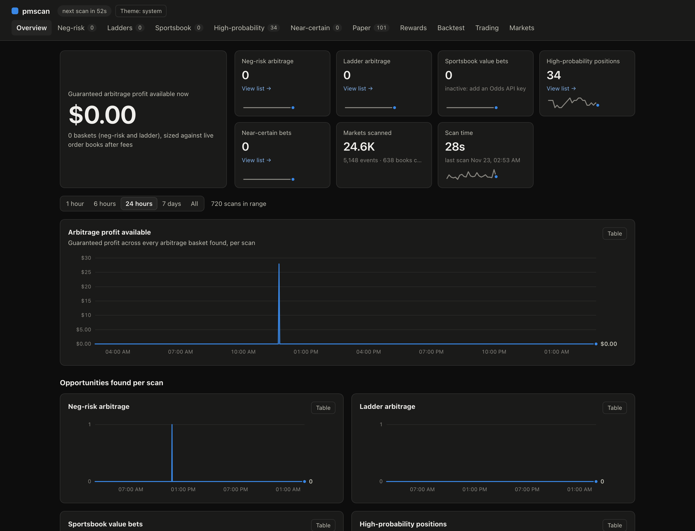
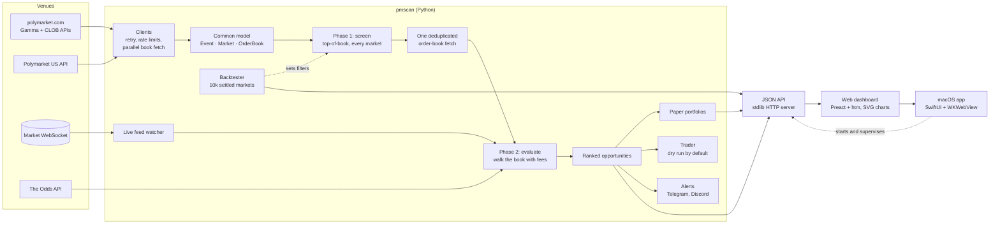
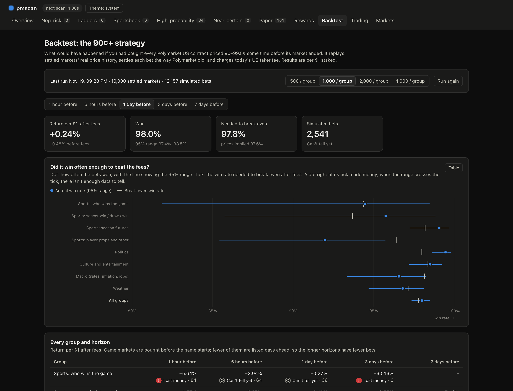
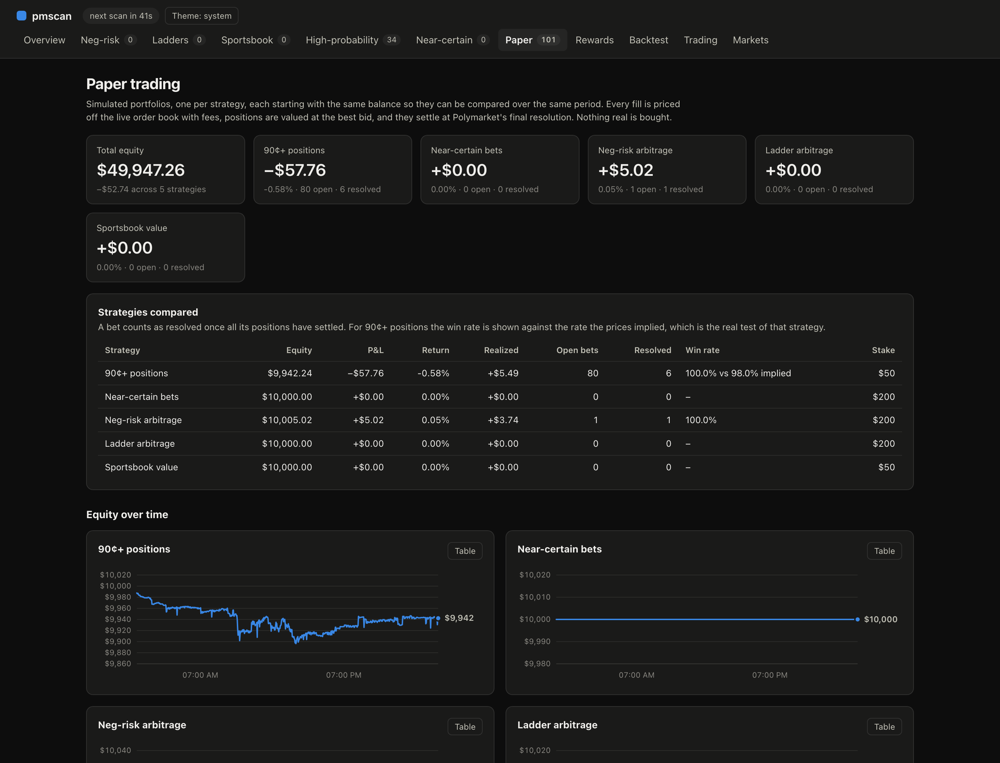
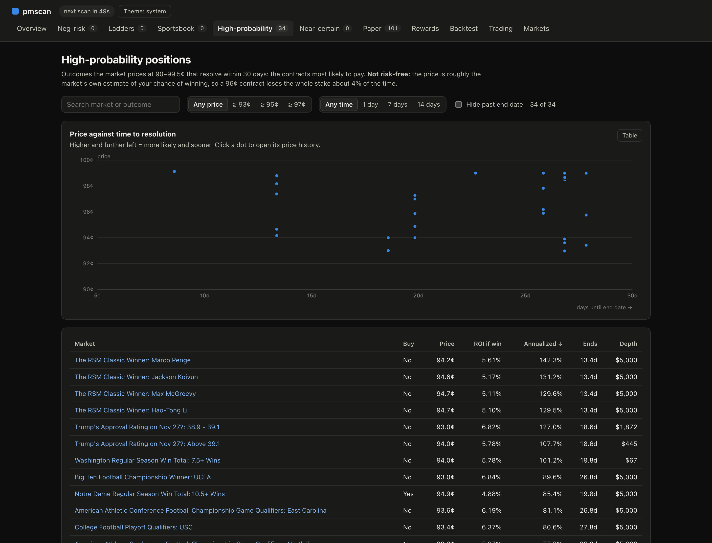
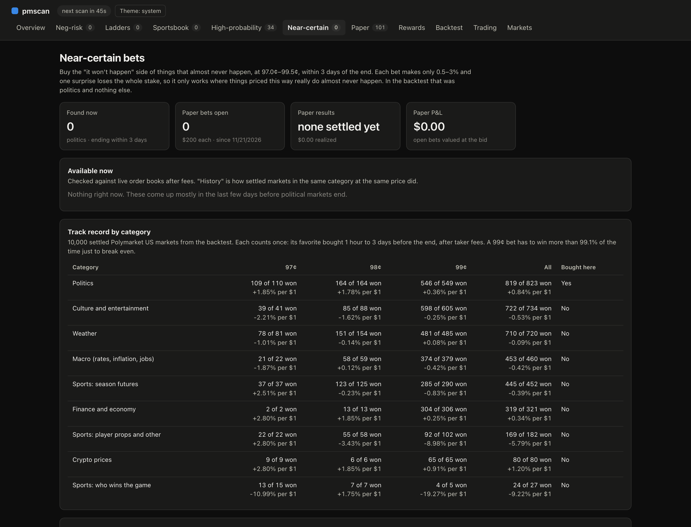

# pmscan

[](https://github.com/DeanTerrizzi/pmscan/actions/workflows/tests.yml)

**A market scanner, backtester and paper-trading system for Polymarket prediction markets, with a
web dashboard and a native macOS app.**

Every couple of minutes pmscan reads all of Polymarket's open markets (about 25,000 markets in
5,000 events), looks for trades with a structural or statistical edge, and prices each one against
the live order book after fees. A backtest on 10,000 settled markets decides which strategies are
worth running. Each one gets its own simulated $10,000 portfolio, so they can be judged on real
fills before any real money is involved.



> This is a public, sanitized copy of a private repository. Credentials, account details, local
> configuration and collected data are excluded. It's a personal research project: paper trading
> only, not affiliated with Polymarket, and not investment advice.

## At a glance

| | |
|---|---|
| **Languages** | Python 3.11+ (about 7,000 lines), JavaScript (2,000), Swift (1,900) |
| **Tests** | 160 pytest tests, no network needed; Ruff lint; CI on every push |
| **Scan** | About 25k markets in about 30 s on either venue, plus a live WebSocket feed |
| **Strategies** | 2 arbitrage, 1 sportsbook comparison, 2 high-probability yield, plus liquidity rewards |
| **Evidence** | Backtest over 10,000 settled markets and 12,000 simulated bets; 5 paper portfolios plus a rewards paper test |
| **Dependencies** | `httpx` and `rich` at runtime. Frontend is Preact + htm, vendored, with no build step |

## What it does

- **Scans two venues.** It reads polymarket.com and Polymarket US (a separately regulated
  exchange with its own API) and normalizes both into one data model.
- **Finds and prices opportunities** with five strategies:
  - Arbitrage, where the payout is known in advance:
    - **Neg-risk baskets:** buying every outcome of a mutually exclusive event for less than $1.
    - **Ladder pairs:** nested markets priced out of order, such as "above $110k" trading higher
      than "above $100k".
  - Statistical bets:
    - **Sportsbook value:** Polymarket prices compared against de-vigged bookmaker consensus.
    - **High-probability yield:** contracts at 90¢ or more.
    - **Near-certain bets:** contracts at 97¢ or more.
- **Backtests** the high-probability strategies on settled markets' real price history, with
  Wilson confidence intervals per category and horizon. Strategies the data doesn't support are
  turned off.
- **Paper-trades** each strategy in its own portfolio. Fills walk the live order book with fees,
  positions are valued at the bid, and bets settle at the official resolution.
- **Can trade for real**, though it's off by default. The safety model:
  - dry run unless started with `--live`;
  - per-trade and per-day caps;
  - order books re-checked right before trading;
  - all legs sent together as Fill-or-Kill orders;
  - if only some legs fill, they're sold back automatically, and trading halts if that fails.
- **Runs as a Mac app.** The SwiftUI app starts the Python service, shows the dashboard,
  keeps keys in the Keychain, and runs from the menu bar at login.

## Architecture



More: **[docs/ARCHITECTURE.md](docs/ARCHITECTURE.md)**, which covers the components, data flow,
storage, concurrency and the Mac app.

## Engineering decisions

The full reasoning and trade-offs are in **[docs/DECISIONS.md](docs/DECISIONS.md)**. The main ones:

1. **Two-phase scan.**
   - Strategies first screen every market on cheap top-of-book quotes, then the real order books
     are fetched once, deduplicated across strategies.
   - Only promising markets cost a request, and 25k markets fit in about 30 seconds.
2. **No midpoint math.**
   - Every opportunity is sized by walking the actual order book, with the venue's fee formula
     applied per fill.
   - A "profit" that disappears after 10 shares is never reported.
3. **One model, two venues.**
   - Polymarket US is mapped into the same `Market` and `OrderBook` types, so every strategy, the
     backtester and the paper trader work on both venues unchanged.
4. **The data decides which strategies run.**
   - Backtests removed whole categories, such as player props and game winners.
   - The spread at entry turned out to be the strongest predictor of losses, so 90¢+ bets now
     need books within 2¢.
   - That spread is measured at a $50 order size, after dust orders on empty books were found
     faking 1¢ spreads.
5. **Isolated failure modes in paper trading.**
   - One portfolio per strategy, so results can be compared directly.
   - At most 3 bets per event, and at most 20% of the balance per league, because related markets
     fail together.
6. **No build step and almost no dependencies.**
   - The dashboard is plain ES modules (Preact + htm, vendored) served by Python's
     `ThreadingHTTPServer`.
   - Charts are hand-written SVG.
   - Nothing to install beyond `uv sync`.
7. **Secrets never touch the repo or the config file.**
   - Environment variables or `.env` for the command line, the macOS Keychain for the app.
   - The live trader is meant to run on a revocable session key, not the wallet's main key.

## What the data showed

The research write-up is in **[docs/RESEARCH.md](docs/RESEARCH.md)**. In short:

- **Most "obvious" edges lose money after fees.** Buying long shots under 20¢ lost 40–60% per
  dollar. Taker trades at 20–80¢ lost 2–20%.
- **High-probability contracts (90¢+) break even overall**, but the result varies by category.
  Political markets made roughly +1% per dollar; player props lost 2–4%.
- **Order-book spread is the filter that matters most.** Bets bought at a spread of 2¢ or less
  won 98.7–99.4% of the time (+1.3–1.9% per dollar). Above 5¢ they won only 59–91%.
- **Resting limit orders suffer adverse selection.** Filled bids won 89% of the time against 98%
  for taker entries.
- **Cross-venue arbitrage is essentially gone after fees.** The median price gap was 0.5¢ to
  polymarket.com and 0.8¢ to Kalshi.

## Screenshots

| Backtest by category and horizon | Paper portfolios, one per strategy |
|---|---|
|  |  |
| **High-probability positions, live** | **Near-certain bets with their track record** |
|  |  |

## Testing

```bash
uv sync --all-extras
uv run pytest -q          # 160 tests, about 3 seconds, no network
```

- **No network in tests.** HTTP clients are replaced by small fakes that serve order books and
  resolutions, so strategies, the paper trader and the trader run against known books.
- **Order-book math is tested at the boundaries:** fills across several levels, average price,
  budget and price caps, fees, empty books, and books made only of dust orders.
- **The trader's safety rules each have a test:**
  - never crossing the scanned price, or trading edges too small after fees;
  - daily caps and dry-run ledgers;
  - partial fills that are sold back, and the halt when that fails;
  - delayed legs and missing order results.
- **Venue parsing is tested against sample payloads** for both APIs, including the US feed's
  stream messages and the rules for when outcomes are mutually exclusive.
- **The dashboard's JSON API is tested route by route,** including input validation, caching,
  and a check that file paths can't escape the static directory.
- **CI** runs the Python suite and lint on Linux, and type-checks the Swift app on macOS.

## Running it

```bash
uv sync
uv run pmscan scan          # one scan, results in the terminal
uv run pmscan serve         # dashboard at http://127.0.0.1:8765, rescanning in the background
macos/build.sh --install    # the Mac app (needs the Xcode command line tools)
```

No account or key is needed to scan or paper-trade. The full user manual covers every strategy,
setting and command: **[docs/USAGE.md](docs/USAGE.md)**.

## Project layout

```
pmscan/
  client.py, us.py, parse.py   venue clients → common model (models.py)
  scanner.py                   two-phase scan orchestration
  strategies/                  one module per strategy, shared screen/evaluate interface
  books.py                     order-book walking and fee math
  fast.py                      live WebSocket feed for markets near an edge
  paper.py, trading.py         paper portfolios; live/dry-run execution with safety checks
  backtest.py, rewards.py      backtester; liquidity-rewards scanner
  web.py, static/              JSON API and dashboard
macos/                         SwiftUI app shell
tests/                         pytest suite
docs/                          architecture, decisions, research, user manual
```
