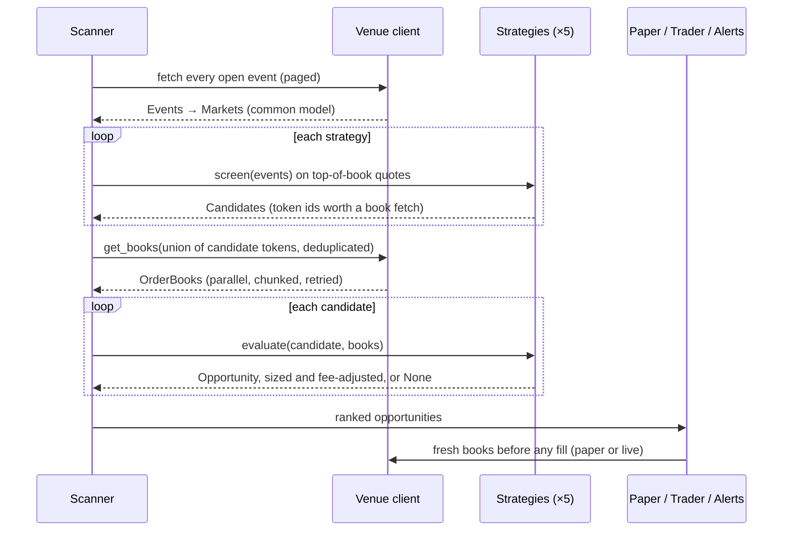

# Architecture

pmscan is a Python service with three front ends:

- a terminal CLI;
- a browser dashboard served by the service itself;
- a native macOS app that starts the service and hosts the dashboard.

Everything below runs in one process except the Mac app, which supervises that process.

## Data flow of one scan

1. **Fetch**
   - `client.py` (polymarket.com: the Gamma metadata API plus the CLOB order-book API) and
     `us.py` (Polymarket US) page through every open event.
   - `parse.py` and `us.py` turn raw JSON into the shared types in `models.py`: `Event`,
     `Market`, `OrderBook`, `Level`, `FeeSchedule`, `Leg` and `Opportunity`.
   - Strategies never see venue-specific JSON.
2. **Screen** (`strategies/*.screen`)
   - Each strategy looks at every market's top-of-book quote, which comes free with the event
     listing.
   - It returns lightweight `Candidate`s naming only the tokens whose full books it needs.
3. **Fetch books, once**
   - The scanner merges every strategy's candidate tokens, removes duplicates, and fetches the
     books in parallel chunks with a thread pool.
   - Requests retry with backoff on 429 and 5xx responses, and honor `Retry-After`.
4. **Evaluate** (`strategies/*.evaluate`)
   - Each candidate is priced by walking the real book with `books.walk_basket`, which buys
     equal share counts of every leg, level by level, with the venue's fee per fill.
   - It stops when the next unit would no longer be profitable.
   - The result is an `Opportunity` with legs, cost, guaranteed or if-win payout, ROI,
     annualized ROI and a score for ranking.
5. **Act**
   - `paper.py` enters simulated positions.
   - `trading.py` plans live or dry-run trades.
   - `alerts.py` pushes new finds to Telegram or Discord.
   - The scan summary is appended to `scans.jsonl` for the trend charts.

## Components

| Module | Responsibility |
|---|---|
| `scanner.py` | Orchestrates fetch → screen → books → evaluate; returns a `ScanResult` |
| `strategies/base.py` | `Strategy` interface (`screen`, `evaluate`), `ScanContext` (config, clock, venue, stats) |
| `strategies/neg_risk_arb.py` | Mutually exclusive outcomes: buy every YES under $1, or every NO under k−1 |
| `strategies/ladder_arb.py` | Infers nested markets from question wording ("above $X", "by <date>") and finds inverted prices |
| `strategies/sportsbook.py` + `odds.py` | De-vigs bookmaker odds, takes the median fair probability, and buys only below it |
| `strategies/high_prob.py` | 90–99.5¢ contracts with category, spread-at-size and depth filters chosen by backtest |
| `strategies/near_certain.py` | Subclass of the above for 97–99.5¢ bets in the final 3 days, tagged with its backtest record |
| `books.py` | Order-book walking, VWAP, fee math, budget and price caps |
| `fast.py` | WebSocket feed for the events closest to an edge, re-evaluated with the same strategy code |
| `paper.py` | One simulated portfolio per strategy: entries, marking at the bid, settlement, per-event cap |
| `trading.py` | Execution with a layered safety model (below) and an append-only trade ledger |
| `backtest.py` | Samples settled markets, replays hourly price history, scores entries with fees |
| `rewards.py` | Polymarket US liquidity-rewards estimator and its own paper test of resting quotes |
| `web.py` | `ThreadingHTTPServer`: background rescans, JSON API, static app, path-safe file serving |
| `config.py` / `env.py` | Typed dataclass config with TOML overrides; secrets only from the environment or `.env` |

### Adding a strategy

1. Subclass `Strategy` and implement `screen` and `evaluate`.
2. Register it in `strategies/__init__.py`.

The scanner, paper trader, alerts, API and dashboard pick it up by name. The scan's book fetch is
shared, so a new strategy adds no requests for markets already being checked.

## Concurrency

- **Book fetches:** a thread pool over chunked batch requests, with one shared `httpx` client
  and connection pooling.
- **Dashboard server:** `ThreadingHTTPServer` serves requests while a background thread rescans
  on an interval. The latest `ScanResult` is swapped in whole, so readers never see a
  half-built scan.
- **Live feed:** runs an `asyncio` loop on its own thread, using the official SDK's streaming
  client.
  - It updates quotes in memory as messages arrive.
  - When a market crosses into an edge, it hands the event back for a normal book fetch and
    evaluation.
  - It reconnects with backoff.
- **Rewards paper test:** ticks on its own timer, checking whether resting quotes would have
  been filled by real trades.

## Storage

Everything is append-only JSON Lines or small JSON documents under `data/<venue>/`. There's no
database, because the access patterns are "append one row per scan" and "read the last N".

| File | Contents |
|---|---|
| `scans.jsonl` | One summary row per scan (counts, profit available, duration) for trend charts |
| `history.jsonl` | Arbitrage and value opportunities as they appear and disappear |
| `trades.jsonl` | Every live or dry-run attempt, with the reason it was skipped |
| `paper/<strategy>/portfolio.json`, `equity.jsonl` | Paper positions and the equity curve; a reset archives rather than deletes |
| `backtest/markets.jsonl`, `history.jsonl` | Cache of settled markets and their price history (reusable, incremental) |

`data/` is git-ignored. Each venue keeps its own directory, so switching exchanges never mixes
results.

## Live trading safety model

This is implemented in `trading.py` and covered by `tests/test_trading.py`. Each layer must pass
before an order is sent.

1. **Dry run by default.** Live mode needs the `--live` flag and a key.
2. **Opt-in strategies only**, within per-trade and per-day USD caps. Only live spend counts
   toward the daily cap.
3. **Re-check before trading.** The books are fetched again and the basket re-sized; no leg
   may cross the price the scan evaluated, and the edge must still clear minimum profit and ROI
   after fees.
4. **All or nothing.** Every leg is signed first, then all legs are posted together as
   Fill-or-Kill orders with a maximum price.
5. **Partial fills are contained.** If the book moved between legs, the filled legs are sold
   back. If that fails, or unwinding is turned off, trading halts until a human runs
   `pmscan trade resume`.

## Web dashboard

- **No build step.** `static/app` is plain ES modules using Preact with `htm` tagged templates;
  both are vendored with their licenses.
- **Views:** one module per view, with a hash router and a small `usePoll` hook for live data.
- **Charts:** hand-written SVG in `charts.js` (line, scatter, interval and sparkline charts).
  Every chart is labelled for screen readers and can switch to a table view.
- **Theme:** light and dark follow the system, with a manual override.
- **Embedded mode:** when loaded inside the Mac app with `?embedded=1`, the web header hides,
  and route changes are posted to the native sidebar through a `WKScriptMessageHandler`.

## macOS app

The app is a SwiftUI shell, about 1,900 lines, built with plain `swiftc` by `macos/build.sh`
(no Xcode project).

- **`Backend.swift`** starts `python -m pmscan.cli serve --exit-with-parent` from the project's
  virtualenv.
  - It picks a free port, preferring a fixed one, and waits for the server to answer.
  - It restarts the server when settings change.
  - It logs to a file.
- **`WebStore.swift`** owns the single `WKWebView`. The native sidebar drives navigation, and
  the web app reports route changes back.
- **`Account.swift`** stores keys in the Keychain (`SecItem*`). They're passed to the child
  process only through its environment, and never written to disk.
- **`KeepRunning.swift`** has three parts:
  - a per-user LaunchAgent to start at login (the app supports macOS 12, which lacks
    `SMAppService`);
  - a menu-bar `NSStatusItem`;
  - a background mode with no window or Dock icon.
- **`Notifier.swift`** sends native notifications for new arbitrage and trading halts.
- **`Snapshot.swift`** is a developer tool that tours the pages and saves screenshots without
  screen-recording permission, for checking the layout.
